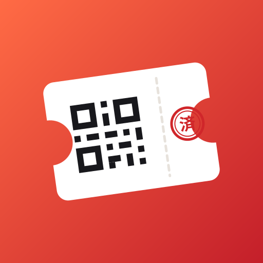
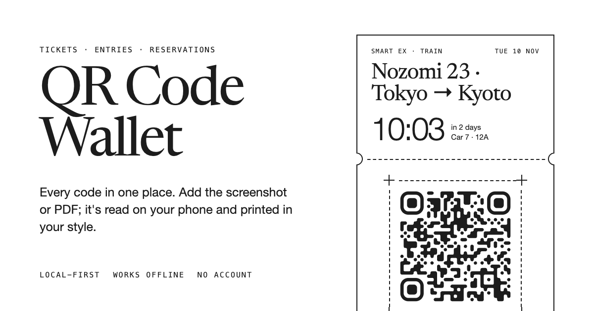
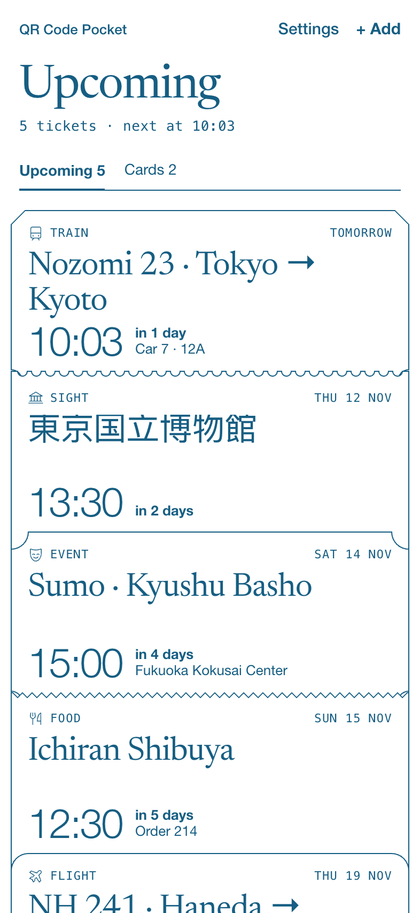
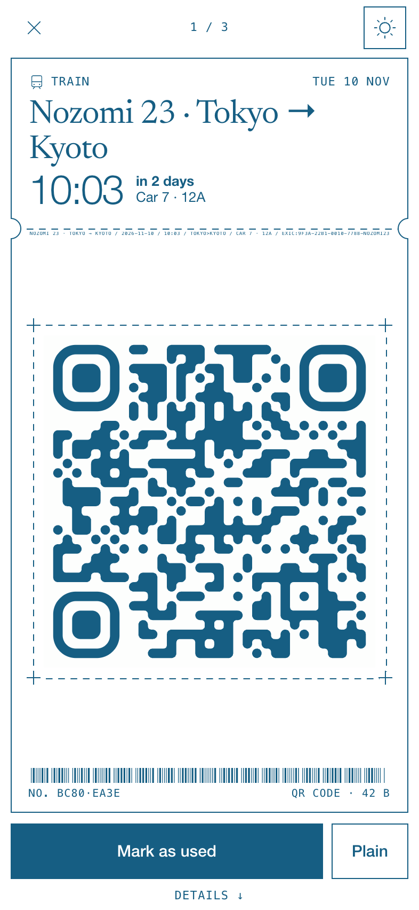
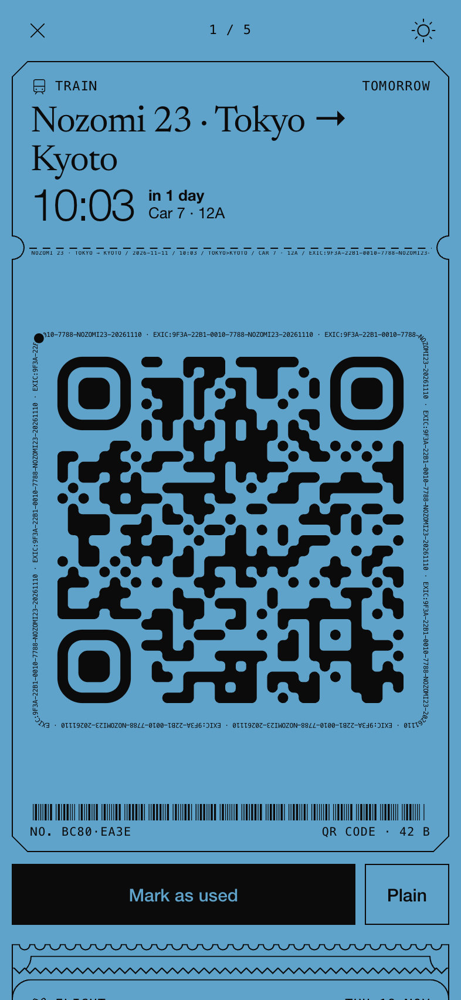

<p align="center">
  
</p>

<h1 align="center">QR Code Pocket</h1>

<p align="center">
  <strong>Keep all your QR codes in your pocket: tickets, entries, reservations, boarding passes.</strong><br>
  Save a QR code from a screenshot or PDF, keep it in one place, show it full screen at the gate.<br>
  Local-first. Works offline. No account. Installs to your Home Screen.
</p>

<p align="center">
  
</p>

Travelling, you collect QR codes everywhere: Shinkansen and rail tickets, museum and attraction entries,
restaurant bookings, takeaway order numbers, boarding passes, event tickets. They end up as screenshots in
your camera roll and PDFs in your email. QR Code Pocket keeps them in one place, reads what they are, and
puts the right one on screen when you need it.

People call this a QR code wallet, a QR code keeper, holder or saver; whatever the word, the job is the
same: keep the codes you'd otherwise dig out of screenshots and emails, and show the right one at the gate.

It's a progressive web app (PWA): open it in Safari or Chrome and add it to your Home Screen. No App Store,
no sign-up, and your codes never leave your phone.

## Save any QR code, from anywhere

- **From a screenshot.** Pick it from Photos; the QR code is found and decoded on your phone.
- **From a PDF ticket.** E-tickets from email: every page is scanned, and the PDF's text is read for the details.
- **With the camera.** Scan a printed voucher or a code on someone else's screen.
- **Paste or type.** A copied image, a link, or a booking number to turn into a QR code.
- **From the share sheet.** On iPhone via a one-tap Shortcut; on Android, the app is a share target.

Supported codes: **QR**, **Aztec** (airline boarding passes), **PDF417**, **Data Matrix**, **Code 128**,
**EAN-13**, **ITF** and more (via [zxing-cpp](https://github.com/zxing-cpp/zxing-cpp) compiled to WebAssembly).

## It reads the ticket for you

Most of the time you just confirm. The details come from two places, and each value says which:

- **The code itself:** an airline boarding pass (IATA BCBP) gives passenger, flight, route, date, seat and
  booking reference; booking links from Klook, KKday, TableCheck, Smart EX, Eki-net and others give the
  issuer, order number and visit date; calendar codes give the event, place and start time.
- **The text around it:** read on your phone in Japanese and English
  ([Tesseract](https://github.com/naptha/tesseract.js), offline). It recognises Shinkansen reservations
  (train, departure and arrival stations, car and seat), museum entries, restaurant bookings and dates in
  Japanese and Western formats.

## Show it at the gate

<p>
  
  
  
</p>

- **A wallet, not a list.** Upcoming tickets sit in a stack, the next one on top with a countdown. Tap one
  and it springs up while the rest tuck into a pile below; pull it down to put it back, flick sideways
  through the rest. Hold one and drag it through the stack to put your tickets in your own order.
- **The code as big as the screen allows**, with the screen kept awake. **Bright** puts it on a lit plate.
- **Plain** shows the classic black-on-white code for fussy scanners; **Original** shows your screenshot.
- **Mark as used** postmarks the ticket into **Collected**: the trip, ticket by ticket, with a few numbers on top.
- **Share** a ticket as an image, printed in your colours.

## Printed in your style

Every ticket is printed in exactly two colours, like a print job. Pick a colour from the omakase set of
traditional Japanese colours (墨 Sumi, 藍 Ai, 朱 Shu, 抹茶 Matcha and more) or your own, and a look for day
and for night. Codes are redrawn from their exact content in one of nine module styles (classic, tiles,
liquid, soft, dots, molecule, pills, engraved, halftone), re-encoded with high error correction. Every
style is checked against a real decoder (`scripts/qr-scan-test.mjs`).

## Private by design

- Everything is stored in your browser's storage on your phone (IndexedDB). There is no server-side copy.
- Codes are decoded, and screenshots read, on the device. Nothing is uploaded.
- No account, no analytics, no ads.
- Export a backup file any time; import it on a new phone.

## FAQ

**How do I save a QR code from a screenshot on iPhone?** Open QR Code Pocket, tap **+ Add**, choose
**Photos & files**, pick the screenshot. The code is decoded on your phone.

**Can I add these codes to Apple Wallet or Google Wallet?** Not yet. It's planned (see the research in
[docs/research](docs/research)). Until then, QR Code Pocket itself is the wallet.

**Does it work offline?** Yes, once it's on your Home Screen: the app, the code reader and the text
recognition all work without a connection.

**Will the gate scanner accept a redrawn code?** It encodes the same content, so it reads the same. If one
refuses, use **Plain** (classic black on white) or **Original** (your screenshot).

**Is it free?** Yes.

## How it compares

| | QR Code Pocket | Screenshot album | "QR to Apple Wallet" apps |
| --- | --- | --- | --- |
| Reads the details for you | Yes, from the code and the ticket text | No | Mostly typed by hand |
| Works offline | Yes | Yes | Varies |
| Uploads your codes | No | No | Usually, to sign the pass on a server |
| Keeps used tickets as a record | Yes, Collected | Mixed in with photos | No |
| Account or App Store needed | No | No | Yes |

## Develop

```sh
pnpm install
pnpm build                          # copies OCR/pdf.js assets into public/, builds dist/
node server.mjs                     # dist + share inbox on 127.0.0.1:5182
scripts/shortcut.sh https://<host> && pnpm build   # signed iOS "Add to" Shortcut for that host
```

Vite, React and TypeScript, with plain CSS. [zxing-wasm](https://github.com/Sec-ant/zxing-wasm) reads and
writes the codes, [pdf.js](https://mozilla.github.io/pdf.js/) opens PDFs,
[tesseract.js](https://github.com/naptha/tesseract.js) reads text, [motion](https://motion.dev) springs
the wallet stack, [Phosphor](https://phosphoricons.com) draws the icons, and
[vite-plugin-pwa](https://vite-pwa-org.netlify.app) makes it installable.

| Path | What's there |
| --- | --- |
| `src/scan/` | Code detection and drawing, PDF pages, OCR, ticket-text and payload parsing |
| `src/store/` | IndexedDB, tickets, backup |
| `src/ui/` | Wallet stack, ticket face, sheets, style pager, review flow, settings, QR module styles |
| `src/theme.ts` | The two-colour system: day and night looks, omakase colours |
| `server.mjs` | Static server and share inbox, no dependencies |
| `scripts/` | Decode test for the code styles, brand assets, OCR assets, the iOS Shortcut |

**Brand assets:** `public/favicon.svg` is the app icon; all PNG icons and iOS launch screens are generated
from it at build. `public/og.png` is the share image. Both are made by `scripts/brand/`. Build with
`SITE_URL=https://your.domain` so canonical, Open Graph and sitemap URLs are absolute.

## License

[MIT](LICENSE)
